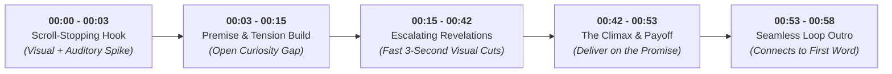

<div align="center">

# ⚡ ShortsPulse AI: YouTube Shorts Agent
### *Retention-Engineered AI Agent & Toolkit for Viral 60-Second Videos*

[](LICENSE)
[](https://python.org)
[](https://aistudio.google.com/)
[](https://aistudio.google.com/)
[](CONTRIBUTING.md)

<p align="center">
  <b>Research • Script • Score Hooks • Lint Packaging • Maximize Retention (APV > 100%)</b>
</p>

---

</div>

## 💡 What is ShortsPulse AI?

**ShortsPulse AI** is an open-source AI agent engineered to generate, critique, and package high-retention 60-second YouTube Shorts, Instagram Reels, and TikToks. 

Powered natively by **Google Gemini** (`gemini-2.5-flash`), it operates with **100% free-tier compatibility** via [Google AI Studio](https://aistudio.google.com/). No Claude subscriptions or expensive API credits required.

---

## 📈 The 60-Second Retention Architecture

Shorts live or die in the first 3 seconds and the loop ending. Every script generated by the agent is strictly timed to proven algorithmic milestones:



---

## 🚀 Key Features

| Capability | What It Does | Why It Matters |
| :--- | :--- | :--- |
| **🪝 21-Formula Hook Engine** | Generates 5 distinct psychological angles per topic (Contrarian, Micro-Story, Secret Mechanism, etc.) | Prevents boring, generic openers and catches the viewer's attention instantly. |
| **📊 Algorithmic Hook Scorer** | 5-factor heuristic panel (`tools/hookscore.py`) rating brevity, tension, and cadence offline | Quantifies hook strength before shooting or voiceover rendering. |
| **🎬 Retention Scripting** | Generates complete 60s scripts with timecodes, dialogue, and 9:16 visual prompts | Ready-to-record scripts with pacing optimized for mobile screens. |
| **🔍 Title & Thumbnail Linter** | Validates title length (<50 chars for mobile) and checks thumbnail text synergy | Prevents title cut-offs and redundant thumbnail text. |
| **🏷️ Viral SEO & Tagging** | Produces high-intent search tags, hashtags, and description summaries | Maximizes discoverability on YouTube Shorts shelf & Search. |
| **🎙️ Channel Voice Profiles** | Customizable tone, audience, and banned words in `config/voice.md` | Keeps tone consistent across dozens of video uploads. |

---

## 📦 Quick Setup

### 1. Clone & Navigate
```bash
git clone https://github.com/Chaitu328/youtube-shorts-agent.git
cd youtube-shorts-agent
```

### 2. Install Dependencies
```bash
pip install -r requirements.txt
```

### 3. Get Your Free Gemini API Key
1. Visit [Google AI Studio](https://aistudio.google.com/).
2. Click **Get API key** (free tier available).
3. Copy `.env.example` to `.env`:
```bash
copy .env.example .env
```
4. Paste your key into `.env`:
```env
GEMINI_API_KEY=your_gemini_api_key_here
```

### 4. Verify Connection
```bash
python agent.py test
```

---

## 🛠️ Usage & Commands

### 1. Generate & Score 5 Viral Hooks
Generates 5 distinct hook formulas ranked by viral probability:
```bash
python agent.py hook --topic "The Lost Library of Alexandria"
```

### 2. Generate a Complete 60-Second Short Script
Outputs timecodes, narration dialogue, and 9:16 vertical visual prompts for every scene:
```bash
python agent.py script --topic "Why Did the Roman Empire Really Fall?"
```

### 3. Lint Title & Thumbnail Packaging
Verify mobile truncation limits and avoid redundancy between thumbnail and title:
```bash
python agent.py package --title "The 1 Mistake That Destroyed an Empire" --thumb "HE WAS WRONG"
```

### 4. Generate SEO, Hashtags & Tags
Get search-optimized titles, hashtags, and YouTube Studio tags:
```bash
python agent.py seo --topic "Bizarre Historical Coincidences"
```

---

## 🧰 Standalone Offline Tools (Zero Dependencies)

The standalone tools in [`tools/`](tools/) run with pure Python 3 without requiring external libraries or API keys:

```bash
# Score any hook sentence offline
python tools/hookscore.py --hook "99% of people charge their phone completely wrong."

# Lint title and thumbnail text
python tools/title_linter.py --title "How One Typo Cost $400 Million" --thumb "COSTLY MISTAKE"
```

---

## 📄 Customizing Your Channel Voice

Calibrate the agent to match your exact channel persona by editing [`config/voice.md`](config/voice.md):
- **Channel Niche & Demographics**
- **Pacing & Cadence** (fast & punchy vs. narrative & suspenseful)
- **Taboo Words** (jargon, clichés like *"Did you know"*, or filler words)

---

## 🤝 Contributing

Contributions are welcome! Please check out [CONTRIBUTING.md](CONTRIBUTING.md) to get started.

---

## 📜 License

Distributed under the [MIT License](LICENSE). Built for creators, developers, and media teams.
